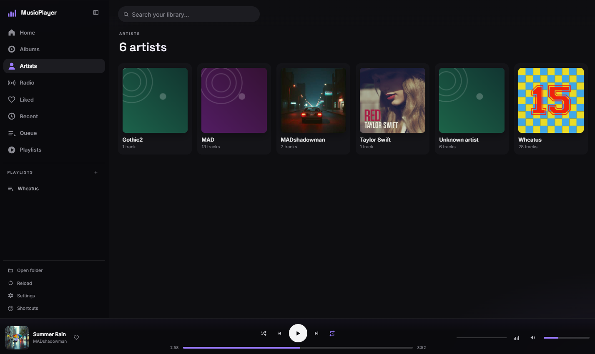

# MusicPlayer

A self-hosted personal music player built with plain HTML, CSS and JavaScript.
Browse your music by album or artist, build playlists, listen to internet radio,
and enjoy audio-reactive visualizations. No build step, npm install or backend required.



## Features

- **Music library:** album and artist views, search, sorting, liked tracks and
  recent listening history. Import a local folder or drag and drop music.
- **Metadata and artwork:** reads ID3, FLAC, Ogg and MP4/M4A tags, including
  embedded cover art, with filename and folder artwork fallbacks.
- **Playback:** shuffle, repeat, editable queue, session restore, preloading for
  gapless transitions, and optional 2-12 second crossfades. Exact transition
  behavior depends on the browser and audio format.
- **Playlists:** create, rename and delete playlists, and add or remove tracks
  individually or in groups.
- **Internet radio:** discover stations through Radio Browser, filter by genre,
  search and save favorite stations.
- **Sound controls:** 10-band equalizer with presets, volume boost, playback
  speed and a sleep timer.
- **Visualizations:** Aurora, Spectrum, Nebula and Tunnel canvas modes, plus
  MilkDrop presets powered by Butterchurn. Press `V` for the full-screen view.
- **Personalization:** themes, accent colors and visualizer settings, plus
  keyboard shortcuts and supported system/lock-screen media controls.
- **Installable web app:** service-worker caching for the app shell and recently
  played hosted audio, with optional screen wake lock on supported browsers.

## Quick start

Install a current [Node.js LTS](https://nodejs.org/) release, then run from the
repository root:

```sh
node tools/serve.mjs 8080
```

Open <http://localhost:8080> and choose **Open folder**, or put audio files inside
`tracks/` and click **Reload**. The included server supports directory discovery
and HTTP range requests. It listens only on the local computer and blocks hidden
files and paths outside this repository. It is a development server; use a static
web host for deployment.

MP3, AAC/M4A, FLAC, Ogg (Vorbis/Opus) and WAV use the browser's native audio
support. Format support varies by browser and operating system.

## Adding music

The player tries these library sources in order:

1. A nonempty `tracks/tracks.json` or `tracks.json` manifest.
2. Directory listings under `tracks/`, including nested folders, if the host
   exposes them.
3. Use **Open folder** or drag and drop files/folders to load a local library.

Local imports stay on your device; they are not uploaded. Reopen the folder after
reloading the page, since the browser's temporary file URLs do not persist.
Personal audio and artwork under `tracks/` are ignored by Git; the sample
`tracks/tracks.json` is deliberately empty.

### Library manifest

Use a manifest on hosts without directory listings, including GitHub Pages:

```json
{
  "tracks": [
    {
      "id": "nightride",
      "title": "Nightride",
      "artist": "Synthia",
      "album": "Neon Drive",
      "src": "tracks/nightride.mp3",
      "art": "tracks/cover.jpg",
      "duration": 214
    }
  ]
}
```

`src` and `art` paths are relative to the **player page**, not the manifest file.
Absolute URLs also work, subject to the host's CORS rules. Keep track IDs stable
so saved playlists and likes can refer to the same tracks. Duration is in seconds;
missing metadata is filled in where available. You can select another manifest
with `?manifest=path/to/library.json`.

Folder imports recognize `Artist - Title` filenames and use folder names as
fallback metadata. Images named `cover`, `album`, `folder` or `front` are preferred
for folder artwork.

## Hosting and GitHub Pages

Serve the repository as static files over HTTPS. No PHP or server-side application
is needed. For GitHub Pages, push the repository, then select the publishing branch
and `/ (root)` under **Settings > Pages**. Relative app paths support project sites
such as `https://username.github.io/MusicPlayer/`.

GitHub Pages does not generate directory listings. Use **Open folder** for local
music, or provide a manifest pointing to hosted audio. Music ignored by Git will
not be included in a Pages deployment. Publish only audio and artwork you have
permission to distribute. For other static hosts, HTTP range support is recommended
for seeking through large audio files. The included `.htaccess` adds cache headers
on Apache hosts that support it; GitHub Pages does not use that file.

## Storage, offline use and browser support

- Playlists, likes, history, radio favorites, preferences and playback session
  information are stored in `localStorage` for this browser and site. Clearing
  site data removes them; there is no account or cloud synchronization.
- Installation, service workers and some folder/wake-lock APIs require HTTPS or
  localhost and browser support. Use the local server instead of `file://` for
  the full feature set.
- The service worker caches the app shell and up to 60 same-origin hosted audio
  files. Offline playback depends on successful caching and available browser
  storage; imported files must be reopened and live radio needs a connection.
- Google Fonts, Butterchurn and its presets load from external services. Their
  first use requires internet access; cached assets may be available offline.
- Radio availability depends on each station. HTTPS pages may block HTTP streams;
  streams without CORS support may play without equalizer/visualizer processing.

## Keyboard shortcuts

| Key | Action |
| --- | --- |
| `Space` | Play / pause |
| Left / right arrow | Seek 5 seconds; change presets in the visualizer |
| Up / down arrow | Adjust volume by 5% |
| `N` / `P` | Next / previous track |
| `S` | Toggle shuffle |
| `R` | Cycle repeat: off, all, one |
| `V` | Toggle full-screen visualizer |
| `L` | Like / unlike current track |
| `M` | Mute / unmute |
| `/` | Focus search |
| `?` | Show shortcut help |
| `Esc` | Close visualizer / menus |

## Development

Edit the source files directly and reload the page. `app.js` contains the player
and UI, `metadata-reader.js` reads audio tags, and `service-worker.js` manages
caching. `tools/dev-server.js` is a compatibility entry point for the same local
server, defaulting to port 5178.

Run the server and cache regression checks with:

```sh
node --test tools/readiness.test.mjs
```

## License

[MIT](LICENSE), with original VideoPlayer attribution retained.
See [third-party notices](THIRD_PARTY_NOTICES.md) for external libraries, fonts
and services. The screenshot illustrates a personal library; no music is included.
